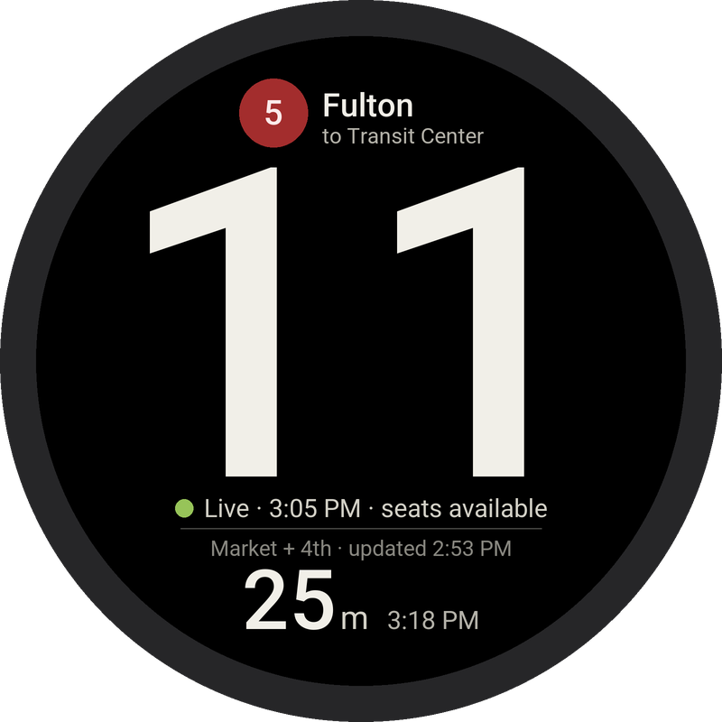

# Muni arrivals display

ESPHome firmware that turns a Waveshare **ESP32-P4-WIFI6-Touch-LCD-4C** (4" round, 720×720)
into a countdown for one Muni line at one stop. As configured, it shows the next two
**5 Fulton** buses on Market St between 5th & 4th Sts (stop 15644), using the
[511.org](https://511.org/open-data/transit) Stop Monitoring API.

<p align="center"></p>

What the screen shows:

- The route badge, name, and headsign across the top
- Minutes until the next bus, as large as the circle allows ("Now" when it's at the stop)
- A status line: a green dot for live GPS predictions, gray for timetable times, the
  arrival time, and how full the bus is when Muni reports it
- The stop name and when the data was last refreshed (amber if it's more than 5 minutes old)
- The bus after that, in minutes and clock time

The screen redraws every 5 seconds and counts down on the board's own clock. It fetches new
predictions from 511 every 90 seconds, which uses 40 of the 60 requests per hour that a 511
token allows.

## Hardware

- Waveshare ESP32-P4-WIFI6-Touch-LCD-4C (SKU 31522), chip revision v3.x
- A USB-C cable and power supply. Some USB-C chargers with C-to-C cables won't power the
  board; a USB-A charger with an A-to-C cable always works.

## Files

| File | What it is |
|---|---|
| `muni_display.yaml` | ESPHome device configuration (board, Wi-Fi, fonts, display, 511 fetch) |
| `muni.h` | Reads the 511 response (including gzip decompression) and draws the screen |
| `secrets.yaml.example` | Template for your Wi-Fi details and 511 token |
| `test/` | Desktop tests for `muni.h`; no board needed |
| `tools/` | Scripts that regenerate the test data and the README mockup |
| `docs/mockup.png` | The screen as drawn by `muni.h` in the desktop tests (`tools/render_mockup.py`) |

## Setup

You need a free 511 API token from [511.org/open-data/token](https://511.org/open-data/token)
and Python 3 on your computer. ESPHome downloads its own compiler and tools on the first build.

```sh
git clone https://github.com/<you>/muni-display.git
cd muni-display
python3 -m venv .venv
.venv/bin/pip install esphome
cp secrets.yaml.example secrets.yaml
```

Edit `secrets.yaml` with your Wi-Fi name and password, and put your 511 token in the URL.
`secrets.yaml` is in `.gitignore`, so it stays on your computer.

## Flashing

First time, over USB:

```sh
.venv/bin/esphome run muni_display.yaml
```

Choose the USB port (`/dev/cu.usbmodem…` on a Mac). The first build takes 10–20 minutes.
If the computer can't see the board, hold **BOOT**, tap **RESET**, release **BOOT**, and try
again.

After that, run the same command and choose **Over The Air** to update over Wi-Fi. Your
computer must be on the same network as the board. On macOS, Terminal also needs
**System Settings → Privacy & Security → Local Network** turned on.

## Using a different line or stop

Change the values under `substitutions:` at the top of `muni_display.yaml`:

| Setting | Meaning |
|---|---|
| `route` | The `LineRef` to show, for example `5`. Other lines at the stop are ignored. |
| `route_name` | Name shown next to the badge |
| `stop_label` | Short stop name for the status line |
| `refresh` | Time between 511 fetches. Keep it at 60 seconds or more. |

Then change `stopcode=` in the URL in `secrets.yaml`. Muni stop codes are the five-digit
numbers on stop signs and in 511's data.

## Hardware notes for this board

These took some debugging to find, so they're recorded here for anyone else using the 4C.

| Symptom | Cause | Fix in `muni_display.yaml` |
|---|---|---|
| Crash loop right after `2nd stage bootloader` | Built for engineering-sample chips (rev < 3.0). The `esp32-p4-evboard` board setting does this. | No `board:`; `variant: esp32p4` and `engineering_sample: false` |
| `lcd.dsi: can't fetch data from external memory fast enough, underrun happens` | PSRAM defaults to 20 MHz | `psram: speed: 200MHz` |
| `ESP-Hosted link not yet up`, then an SDIO timeout and a watchdog reset | Wrong pins for the ESP32-C6 Wi-Fi chip | SDIO on GPIO 18/19/14/15/16/17, reset on GPIO54 (confirmed in [esphome#19990](https://github.com/esphome/esphome/issues/19990)) |
| Board runs but the screen stays dark | The backlight on GPIO26 is active-low | `inverted: true` on the backlight output |
| `rotation: 180` has no effect | The panel ignores ESPHome's hardware flip | `transform: disabled` plus `dimensions`, so ESPHome rotates in software |
| Pieces of an earlier number stay on screen | ESPHome's `mipi_dsi` clears its buffer without marking it changed, then sends only the area that was redrawn | `muni.h` marks two hidden corner pixels each frame so the whole frame is sent |

The panel reset is on GPIO27, per Waveshare's board support code.

The 511 API always sends **gzip-compressed** JSON with a byte-order mark at the start,
whatever the request asks for. `muni.h` includes a small inflate decoder for this.

## Desktop tests

The tests check the time parsing, the gzip decoder (including thousands of corrupted
inputs), and that every screen state fits inside the circle with at least 8 px to spare.
They measure text with the real Roboto metrics at the sizes the firmware uses.

```sh
c++ -std=c++17 -Itest/stubs test/test_muni.cpp -o /tmp/test_muni && /tmp/test_muni
```

If you change a font size in `muni_display.yaml`, build the firmware once (so ESPHome
downloads Roboto), then run `python3 tools/gen_font_metrics.py` and rerun the tests.
`tools/gen_gzip_fixtures.py` rebuilds the gzip test cases from `test/sample_response.json`.

## Credits and licenses

- Released under the MIT License (see `LICENSE`).
- The board, Wi-Fi, and display settings started from a Sunclock ESPHome project for the
  same board.
- The gzip decoder in `muni.h` follows the structure of Mark Adler's `puff` reference
  inflater (zlib license).
- Text is set in [Roboto](https://fonts.google.com/specimen/Roboto) (Apache License 2.0),
  which ESPHome downloads at build time. `test/stubs/font_metrics.h` contains glyph
  measurements derived from it.
- Transit data is provided by [511.org](https://511.org) and used under the
  [511 Data Disseminator Agreement](https://511.org/sites/default/files/pdfs/511_Data_Agreement_Final_0.pdf),
  which requires crediting 511.org as the data provider.
